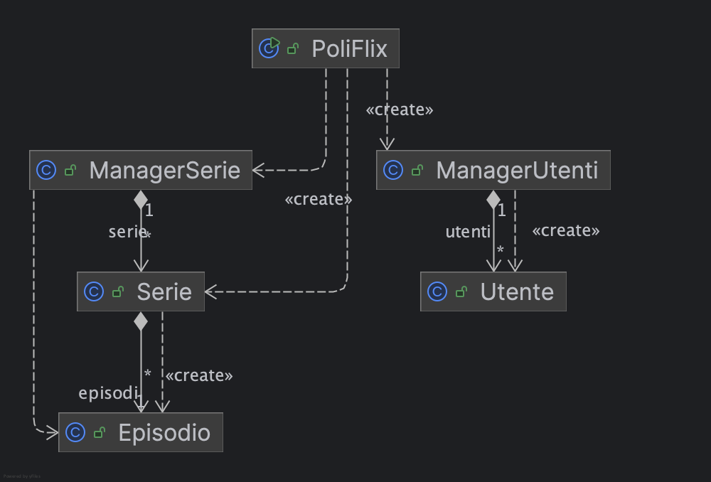
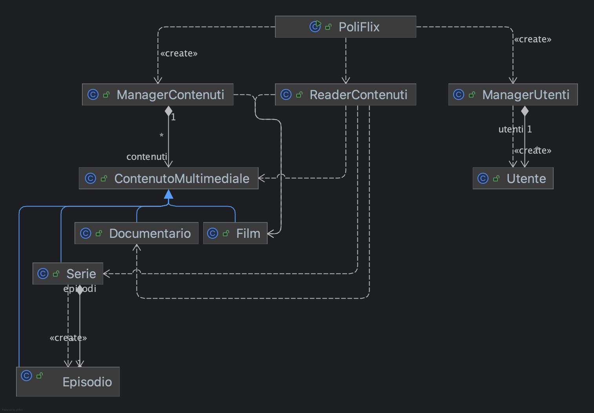
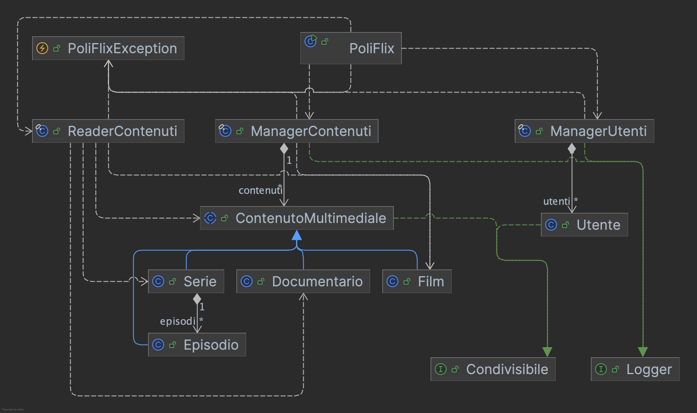
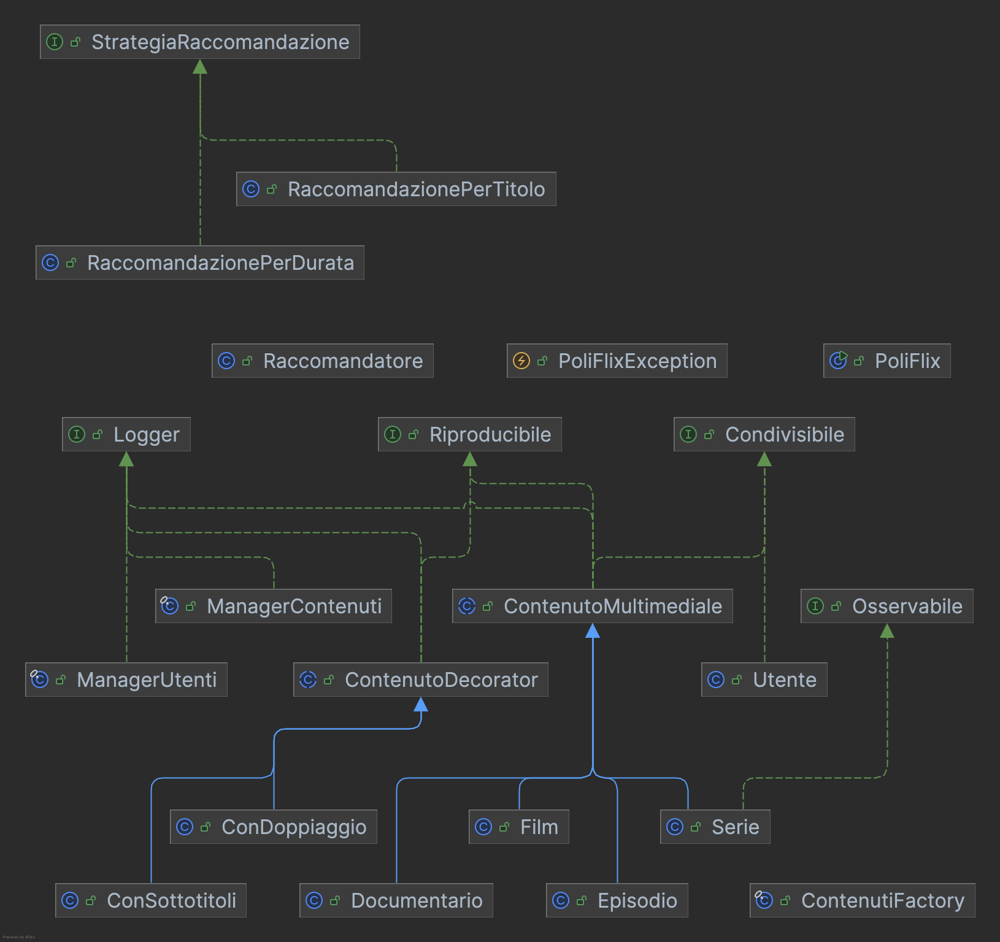

Questo repository raccoglie gli esempi mostrati a lezione. 
Di seguito, la descrizione, package per package, degli argomenti trattati:

<strong>1) Package: warm_up</strong>

- Obiettivo: ripassare le basi di Java e dell’I/O da console, strutture dati semplici e un primo mini‑esempio “PoliFlix”.
- File principali:
  - [main.warm_up.Step1](src/main/warm_up/Step1.java) 
    - Stampa su console
    - Tipi primitivi (int, double, boolean)
    - Stringhe e lettura input con Scanner
    - Ciclo while e condizione di uscita (comando "esci")
  - [main.warm_up.Step2](src/main/warm_up/Step2.java) 
    - Array e for “compatto” 
    - Liste 
  - [main.warm_up.Step3_PoliFlix](src/main/warm_up/Step3_PoliFlix.java) 
    - Mini applicazione testuale: registrazione e login utenti
    - Uso di liste parallele (username/password)
    - Menu a scelta con Scanner e gestione di uno “stato utente loggato”

<strong>2) Package: basi_oop</strong>

- Obiettivo: introdurre le basi della programmazione a oggetti (incapsulamento, oggetti e manager), lettura da file e una piccola app di esempio “PoliFlix”.

2.1) Sottopacchetto: basi_oop.poliflix
- File principali:
  - [poliflix.main.basi_oop.PoliFlix](src/main/basi_oop/poliflix/PoliFlix.java) (main)
    - Entry point dell’applicazione
    - Menu contestuale (non loggato/loggato)
    - Composizione con ManagerUtenti e ManagerSerie
  - [basi_oop.poliflix.serie.Utente](src/main/basi_oop/poliflix/utenti/Utente.java), [serie.poliflix.main.basi_oop.Serie](src/main/basi_oop/poliflix/serie/Serie.java), [serie.poliflix.main.basi_oop.Episodio](src/main/basi_oop/poliflix/serie/Episodio.java)  (modello dominio)
- Cosa mostra:
  - Incapsulamento e oggetti di dominio (Utente, Serie, Episodio)
  - Manager e composizione (PoliFlix + ManagerUtenti, ManagerSerie)
  - Lettura e parsing da CSV (Serie.leggiSerieDaCsv su resources/series.csv)

- Risorse d’esempio:
  - [resources/series.csv](resources/files/series.csv) (file CSV letto da Serie.leggiSerieDaCsv)

2.2) Sottopacchetto: basi_oop.file
- File principali:
  - [file.main.basi_oop.TestFile](src/main/basi_oop/file/TestFile.java) (main)
    - Scrittura su file con PrintWriter
    - Lettura con tre approcci: BufferedReader, Scanner, Files.readAllLines

- Cosa mostra:
  - Incapsulamento e oggetti di dominio (Utente, Serie, Episodio)
  - Manager e composizione (PoliFlix + ManagerUtenti, ManagerSerie)
  - Lettura e parsing da CSV (Serie.leggiSerieDaCsv su resources/series.csv)
  - Menu testuale con stato utente (non loggato/loggato)
  - Collezioni e iterazione su elenchi di oggetti

<strong>3) Package: ereditarieta</strong>

- Obiettivo: introdurre ereditarietà e polimorfismo applicati a PoliFlix; mostrare override dei metodi, upcasting e gestione uniforme di tipi diversi tramite una superclasse comune.

3.1) Sottopacchetto: ereditarieta.poliflix
- File principali:
  - [design_patterns.poliflix.PoliFlix](src/main/oop_avanzato/poliflix/PoliFlix.java) (main)
    - Entry point: menù non loggato/loggato, integrazione con ManagerUtenti e ManagerContenuti
  - Contenuti (gerarchia):
    - [contenuti.poliflix.ContenutoMultimediale](src/main/oop_avanzato/poliflix/contenuti/ContenutoMultimediale.java) (superclasse)
    - [contenuti.poliflix.Film](src/main/oop_avanzato/poliflix/contenuti/Film.java), [contenuti.poliflix.Documentario](src/main/oop_avanzato/poliflix/contenuti/Documentario.java), [contenuti.poliflix.Serie](src/main/oop_avanzato/poliflix/contenuti/Serie.java), [contenuti.poliflix.Episodio](src/main/oop_avanzato/poliflix/contenuti/Episodio.java)
    - [contenuti.poliflix.ManagerContenuti](src/main/oop_avanzato/poliflix/contenuti/ManagerContenuti.java)
    - [contenuti.poliflix.ReaderContenuti](src/main/oop_avanzato/poliflix/contenuti/ReaderContenuti.java)
  - Utenti:
    - [utenti.poliflix.ManagerUtenti](src/main/oop_avanzato/poliflix/utenti/ManagerUtenti.java), [utenti.poliflix.Utente](src/main/oop_avanzato/poliflix/utenti/Utente.java)
- Cosa mostra:
  - Una gerarchia di tipi con superclasse (ContenutoMultimediale) e sottoclassi (Film, Documentario, Serie, Episodio)
  - Polimorfismo su ContenutoMultimediale.riproduci() e override dove necessario
  - Lettura da CSV unica ([ReaderContenuti.leggiDaCsv](src/main/oop_avanzato/poliflix/contenuti/ReaderContenuti.java)) che istanzia il sottotipo in base alla prima colonna (Film/Documentario/Serie)
- Risorse d’esempio:
  - [resources/contenuti.csv](resources/files/contenuti.csv)
  - Diagrammi: [resources/diagrams/PoliFlix_2.png](resources/diagrams/PoliFlix_2.png), [resources/diagrams/PoliFlix_3.png](resources/diagrams/PoliFlix_3.png)

<strong>4) Package: oop_avanzato</strong>

- Obiettivo: mostrare concetti OOP avanzati applicati a PoliFlix: classi astratte e metodi final, interfacce e metodi default, overloading/override, eccezioni custom, serializzazione e lettura da CSV con istanziazione del sottotipo.

4.1) Sottopacchetto: oop_avanzato.poliflix
- File principali:
  - [main.oop_avanzato.design_patterns.poliflix.PoliFlix](src/main/oop_avanzato/poliflix/PoliFlix.java) (main)
    - Entry point: menù non loggato/loggato, integrazione con ManagerUtenti e ManagerContenuti
  - Contenuti (gerarchia):
    - [contenuti.main.oop_avanzato.poliflix.ContenutoMultimediale](src/main/oop_avanzato/poliflix/contenuti/ContenutoMultimediale.java) (superclasse astratta)
    - [contenuti.main.oop_avanzato.poliflix.Film](src/main/oop_avanzato/poliflix/contenuti/Film.java), [contenuti.main.oop_avanzato.poliflix.Documentario](src/main/oop_avanzato/poliflix/contenuti/Documentario.java), [contenuti.main.oop_avanzato.poliflix.Serie](src/main/oop_avanzato/poliflix/contenuti/Serie.java), [contenuti.main.oop_avanzato.poliflix.Episodio](src/main/oop_avanzato/poliflix/contenuti/Episodio.java)
    - [contenuti.main.oop_avanzato.poliflix.ManagerContenuti](src/main/oop_avanzato/poliflix/contenuti/ManagerContenuti.java)
    - [contenuti.main.oop_avanzato.poliflix.ReaderContenuti](src/main/oop_avanzato/poliflix/contenuti/ReaderContenuti.java)
  - Utenti:
    - [utenti.main.oop_avanzato.poliflix.ManagerUtenti](src/main/oop_avanzato/poliflix/utenti/ManagerUtenti.java), [utenti.main.oop_avanzato.poliflix.Utente](src/main/oop_avanzato/poliflix/utenti/Utente.java)
  - Utils:
    - [utils.main.oop_avanzato.poliflix.Condivisibile](src/main/oop_avanzato/poliflix/utils/Condivisibile.java), [utils.main.oop_avanzato.poliflix.Logger](src/main/oop_avanzato/poliflix/utils/Logger.java), [utils.main.oop_avanzato.poliflix.PoliFlixException](src/main/oop_avanzato/poliflix/utils/PoliFlixException.java)

- Cosa mostra:
  - Classe astratta (ContenutoMultimediale) con metodi final e override nelle sottoclassi (Film, Documentario, Serie, Episodio)
  - Interfacce (Condivisibile, Logger) e metodi default; implementazioni nei modelli di dominio
  - Serializzazione/Deserializzazione utenti su file ([resources/files/users.txt](resources/files/users.txt))
  - Gestione errori tramite eccezione custom ([PoliFlixException](src/main/oop_avanzato/poliflix/utils/PoliFlixException.java)) e try/catch nel main

- Risorse d’esempio:
  - [resources/files/contenuti.csv](resources/files/contenuti.csv)
  - [resources/files/users.txt](resources/files/users.txt)
  - Diagrammi: [resources/diagrams/PoliFlix_4.png](resources/diagrams/PoliFlix_4.png)

<strong>5) Package: design_patterns</strong>

- Obiettivo: applicare i principali Design Pattern all’app PoliFlix (Singleton, Factory, Decorator, Observer, Strategy).

5.1) Sottopacchetto: design_patterns.poliflix
- Contenuti e Pattern:
  - Singleton: [ManagerContenuti](src/main/design_patterns/poliflix/contenuti/ManagerContenuti.java), [ManagerUtenti](src/main/design_patterns/poliflix/utenti/ManagerUtenti.java)
  - Factory (creazione oggetti contenuto): [ContenutiFactory](src/main/design_patterns/poliflix/contenuti/factory/ContenutiFactory.java)
  - Decorator (funzionalità aggiuntive in riproduzione): [Riproducibile](src/main/design_patterns/poliflix/contenuti/decorator/Riproducibile.java), [ContenutoDecorator](src/main/design_patterns/poliflix/contenuti/decorator/ContenutoDecorator.java), [ConSottotitoli](src/main/design_patterns/poliflix/contenuti/decorator/ConSottotitoli.java), [ConDoppiaggio](src/main/design_patterns/poliflix/contenuti/decorator/ConDoppiaggio.java)
  - Observer (notifiche): [Osservabile](src/main/design_patterns/poliflix/contenuti/observer/Osservabile.java), [Osservatore](src/main/design_patterns/poliflix/utenti/observer/Osservatore.java)
  - Strategy (raccomandazioni): [StrategiaRaccomandazione](src/main/design_patterns/poliflix/contenuti/strategy/StrategiaRaccomandazione.java), [RaccomandazionePerTitolo](src/main/design_patterns/poliflix/contenuti/strategy/RaccomandazionePerTitolo.java), [RaccomandazionePerDurata](src/main/design_patterns/poliflix/contenuti/strategy/RaccomandazionePerDurata.java), [Raccomandatore](src/main/design_patterns/poliflix/contenuti/strategy/Raccomandatore.java)

- Cosa mostra:
  - Singleton per forzare l'esistenza di un'istanza unica per i due manager
  - Factory per centralizzare la creazione dei contenuti a partire da parametri o dati
  - Decorator per estendere il comportamento di riproduzione (es. sottotitoli, doppiaggio) senza modificare le classi esistenti
  - Observer per notificare gli utenti/observer su eventi (es. nuovi contenuti o stati di riproduzione)
  - Strategy per cambiare a runtime la logica di raccomandazione dei contenuti

- Risorse d’esempio:
  - [resources/files/contenuti.csv](resources/files/contenuti.csv)
  - Diagrammi: [resources/diagrams/PoliFlix_5.png](resources/diagrams/PoliFlix_5.png)

